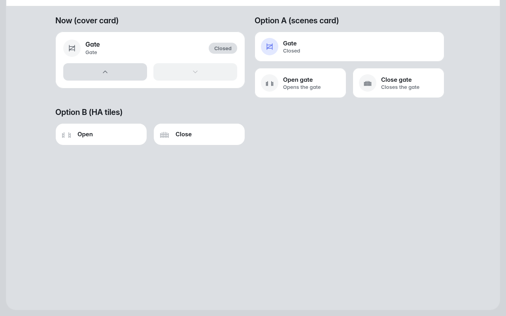

# Fluvy port review — 2026-10-30

**Document:** `LRAN-HA-Fluvy-Port-Review-2026-10-30`
**Status:** **Dated record.** It compares the LRAN dashboards on Fluvy v1.11.3 with the
HA core-card dashboards they replaced, at the end of task H11, and it is not updated.
[`HANDOFF.md`](../HANDOFF.md), the [engineering log](../engineering-log.md) and plan §8.3
are the current record. Where this brief disagrees with them, they win.
**Prepared from:** commit `411d6d3`, the sandbox's installed files, and Fluvy's source at
tag `v1.11.3`

## Summary

The port changed the dashboards only. Every package, automation, script and derived sensor
is unchanged, and so is every entity ID. The sandbox's installed dashboards and packages
match the repository byte for byte.

Of the fifteen features below, nine work as before, four work with a visible loss or a
behaviour change, and two are unverified. Four recommendations need an operator decision,
and the gate's open and close buttons are the first.

## What the port touched, and where each feature stands

**State** means: *same*, it works as before; *changed*, it works but behaves or reads
differently; *unverified*, nothing has shown whether it works.

### Gate dashboard

| Feature | Before (HA core cards) | Now (Fluvy) | State |
|---|---|---|---|
| Gate open and close | A cover tile for state, and two tiles named *Open* and *Close*, each asking for confirmation | One `fluvy-cover-card`, `variant: compact`. Its buttons are an up arrow and a down arrow, and they send at once | **Changed.** No confirmation, by operator choice. The arrows carry no words; the names *Open* and *Close* are only a tooltip, which a phone never shows. See *The gate buttons* |
| Hold gate open | HA tile on the switch | Fluvy compact tile | Same |
| Held open by | Conditional HA tile | Conditional Fluvy tile | Same |
| Alert banners | Six conditional `ha-alert` markdown cards, each with a sentence of explanation | One `fluvy-alerts-card`, rows variant | **Changed.** Each alert shows its name and entity, not the sentence. Four of the six can be snoozed by whoever views them; FIRE and the held-open vehicle cannot |
| SOC gauge | HA gauge, no severity bands | `fluvy-gauge-card`, `gauge: battery` | **Changed.** Fluvy's battery gauge colours a warning below 40 % and danger below 20 %. LRAN's SOC alarm defaults to 25 % and is a helper, so the danger colour disagrees with the alert. The YAML comment above the card still says *No severity bands* |
| Power and link tiles | HA tiles; the link tiles open `/lran-detail/network` | Fluvy compact tiles, same tap action | Same |

### LRAN dashboard

| Feature | Before | Now | State |
|---|---|---|---|
| Read-only rows | HA `entities` cards with section rows | `fluvy-entities-card`, one per former section | Same. A text state shows capitalised |
| Firmware commit and OTA slot | HA `entities` | HA `entities`, kept by operator choice | Same. Fluvy would show `addfd6b` as `Addfd6b` |
| Charts up to 90 days | `history-graph`, line `statistics-graph` | `fluvy-chart-card` | **Unverified** for series in different units. The 24 h and 7 d power charts mix %, mV, mA, W and °F, and the bench has had no BMS or MPPT readings |
| Charts over 90 days | Line `statistics-graph` | Unchanged: Fluvy's chart reads at most 90 days | Same |
| Daily and monthly bars | Bar `statistics-graph` of `change` | `fluvy-history-bars-card` | Same |
| Event log | HA `logbook` | Unchanged: Fluvy has no logbook | Same |

### Maintenance dashboard

| Feature | Before | Now | State |
|---|---|---|---|
| Settings: numbers, selects, booleans | HA `entities` rows with section dividers | `fluvy-helpers-card`, one per former section | **Changed** in layout only. The *Alerts* card is now three cards: Alerts, Health and Reminders |
| *Alerts off* summary | Jinja markdown naming every alert set to `Off` | `fluvy-alerts-card` on `input_select.lran_alert_*`. It counts them, and its sheet names them | Same in effect |
| Restore defaults | HA button row with a confirmation | `fluvy-scene-card` whose `tap_action` keeps the confirmation | **Unverified.** H11 did not press it, so nothing has shown the dialog appearing |

The *Configuration not persisted* banner moved to an alerts card, and the MPPT write
warning stayed an HA markdown card, because Fluvy has no fixed-text card. Both read as
before.

## The gate buttons

**Fluvy's cover card cannot show words on its buttons.** In `cover-card.ts` the open
button's glyph is fixed as `up` and the close button's as `down`. The words go only to
`aria-label` and `title` (`actions()` in `packages/ui/src/parts.ts`). No card option
changes either.

Three ways to show *Open* and *Close* plainly, all rendered on the sandbox on 2026-10-30
on a temporary dashboard that was then deleted:

| Option | What it is | For | Against |
|---|---|---|---|
| **A. Fluvy scenes card** (recommended) | A Fluvy tile for the gate's state, and a `fluvy-scenes-card` with two tiles, *Open gate* and *Close gate*, each with a gate icon and a `tap_action` calling `cover.open_cover` or `cover.close_cover` | Words and icons, in Fluvy's look. No new entity: the scenes card takes any entity when the tile names its own `tap_action` | Neither tile greys out when the gate is already open or closed, as the cover card's buttons do. A press of Open on an open gate is a relay pulse (S-8). The tile's press flash has not been seen on a real command |
| **B. HA tiles** | The two pre-Fluvy tiles, `name: Open` and `name: Close`, with `hide_state` | Known from H2 and H6. HA's tile action can take a `confirmation` again if the operator wants one back | HA's card style in a Fluvy section, as the firmware rows already are |
| **C. Ask upstream** | A Fluvy issue for an option to label the cover card's buttons | Keeps one card | No date, and the dashboard stays as it is until then |

A Fluvy scene card (`fluvy-scene-card`, singular) cannot do it. It accepts only scene,
script, button, input-button and automation entities, so it would need two new scripts.

Option A would replace the cover card in `gate.yaml`. It could also sit beneath the cover
card, at the cost of showing open and close twice.

## Recommendations

1. **Gate buttons: option A.** One edit to `gate.yaml`, rendered at phone width, and an
   Open and a Close with the relay dry-run on, as H6 did, before production.
2. **SOC gauge: decide the bands.** `gauge: ring` draws no thresholds, so the comment holds
   again. Otherwise keep `battery`, and change the comment to say its 40 % and 20 % bands
   are Fluvy's, not LRAN's helpers.
3. **Alert snooze on the Gate dashboard: decide.** *GateLink unavailable*, *Hard-shutdown
   latch*, *Charging inhibited* and *Battery protection* can be snoozed, by default for the
   viewer on every device. A snooze hides the row only; every push still goes out. Setting
   `snooze: "off"` on the hard-shutdown latch, at least, matches its critical severity.
4. **Restore defaults: check the dialog.** Press it on the sandbox and cancel. It costs a
   minute and closes the one unverified safety confirmation left.
5. **Mixed-unit charts: check once GateLink reports BMS and MPPT values.** If the chart
   card puts mV beside % on one scale, split each power chart by unit.
6. **Upstream issues for Fluvy**, at the operator's choice: a label option for the cover
   card, and a way to keep a text state's case. Either would let the dashboards drop an HA
   card.
7. **H10 carries two Fluvy steps that are easy to miss**: set *Scope* to `everywhere` in
   Fluvy's settings panel, and restart any render engine after the install (plan §8.3,
   handoff *Traps*).

## Cleanup done with this brief

- `ha/dashboards/lran.yaml`: the header no longer names the four command buttons, which F1
  replaced. The boot-count comment no longer waits on H5, which is done.
- Plan v0.17: §2's gate control row says F1 is built. §9.3 no longer says Close asks for
  confirmation.
